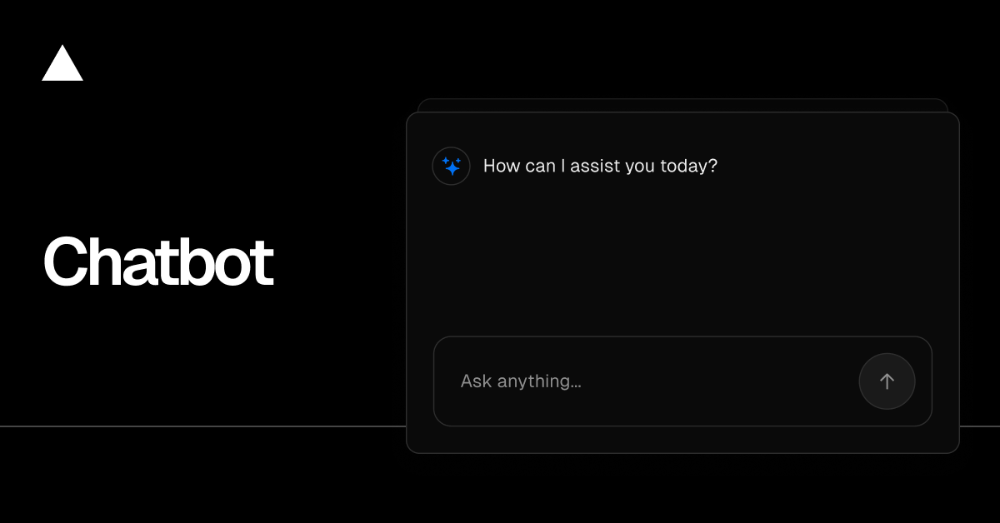

<a href="https://chatbot.ai-sdk.dev/demo">
  
  <h1 align="center">Chatbot</h1>
</a>

<p align="center">
    Chatbot (formerly AI Chatbot) is a free, open-source template built with Next.js and the AI SDK that helps you quickly build powerful chatbot applications.
</p>

<p align="center">
  <a href="https://chatbot.ai-sdk.dev/docs"><strong>Read Docs</strong></a> ·
  <a href="#features"><strong>Features</strong></a> ·
  <a href="#model-providers"><strong>Model Providers</strong></a> ·
  <a href="#deploy-your-own"><strong>Deploy Your Own</strong></a> ·
  <a href="#running-locally"><strong>Running locally</strong></a>
</p>
<br/>

## Features

- [Next.js](https://nextjs.org) App Router
  - Advanced routing for seamless navigation and performance
  - React Server Components (RSCs) and Server Actions for server-side rendering and increased performance
- [AI SDK](https://ai-sdk.dev/docs/introduction)
  - Unified API for generating text, structured objects, and tool calls with LLMs
  - Hooks for building dynamic chat and generative user interfaces
  - Supports OpenAI, Anthropic, Google, xAI, and other model providers via OpenRouter
- [shadcn/ui](https://ui.shadcn.com)
  - Styling with [Tailwind CSS](https://tailwindcss.com)
  - Component primitives from [Radix UI](https://radix-ui.com) for accessibility and flexibility
- Data Persistence
  - [Neon Serverless Postgres](https://vercel.com/marketplace/neon) for saving chat history and user data
  - [Vercel Blob](https://vercel.com/storage/blob) for efficient file storage
- [Auth.js](https://authjs.dev)
  - Simple and secure authentication

## Model Providers

This app uses [OpenRouter](https://openrouter.ai/) through its official AI SDK provider. The model picker loads the full account catalog from OpenRouter's Models API using the server's API key. Text chat models are selectable and grouped by free or paid usage. Models for other modalities appear in the catalog for reference. The first available free chat model is selected when you have no saved selection. OpenRouter's free-tier rate limits apply.

Create an [OpenRouter API key](https://openrouter.ai/keys) and set `OPENROUTER_API_KEY` in `.env.local` for local use or in your Vercel Production environment before redeploying.

## Deploy Your Own

Import this repository into Vercel and set the Production environment variables in [`.env.example`](.env.example).

## Running locally

Use Node.js 22 or later. You will need to use the environment variables [defined in `.env.example`](.env.example) to run Chatbot. It's recommended you use [Vercel Environment Variables](https://vercel.com/docs/projects/environment-variables) for this, but a `.env` file is all that is necessary.

> Note: You should not commit your `.env` file or it will expose secrets that will allow others to control access to your various AI and authentication provider accounts.

1. Enable Corepack: `corepack enable`
2. Link local instance with Vercel and GitHub accounts (creates `.vercel` directory): `pnpm dlx vercel link`
3. Download your environment variables: `pnpm dlx vercel env pull`

```bash
pnpm install
pnpm db:migrate # Setup database or apply latest database changes
pnpm dev
```

Your app template should now be running on [localhost:3000](http://localhost:3000).
